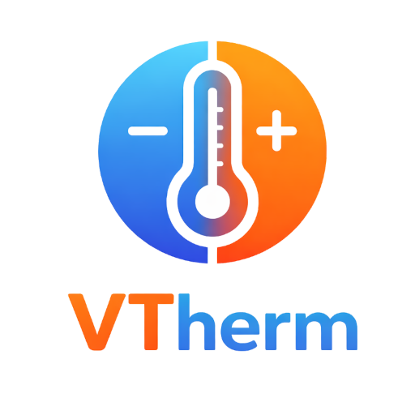
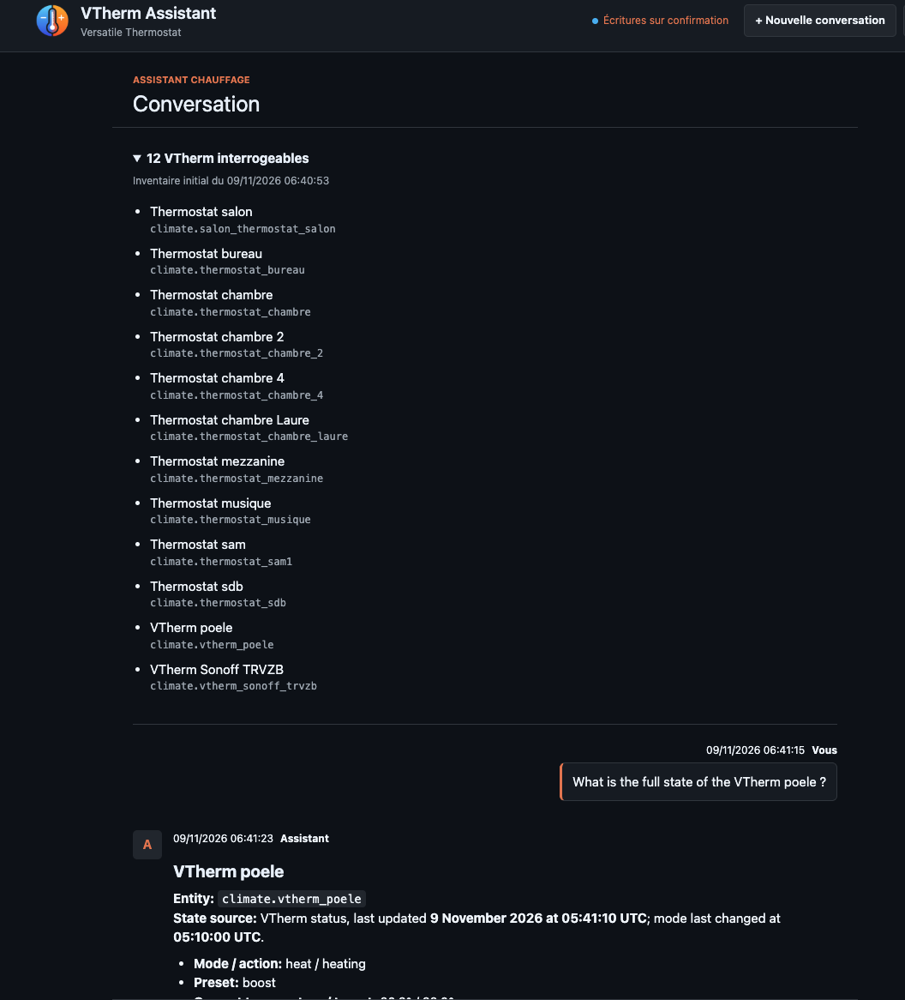
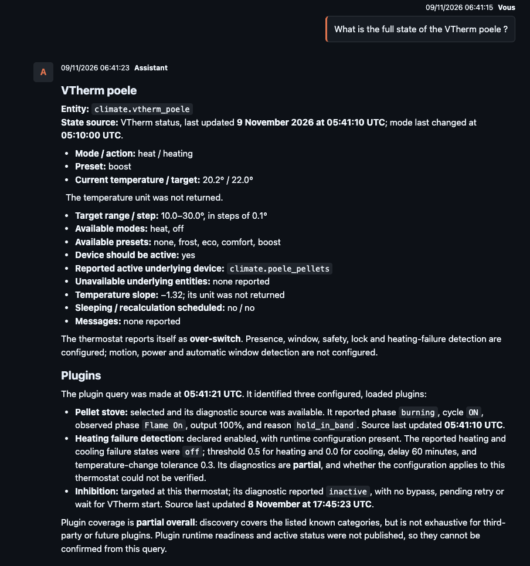
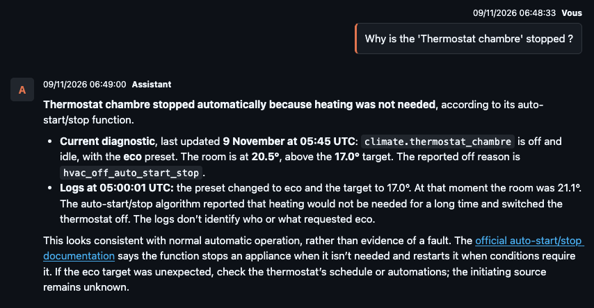
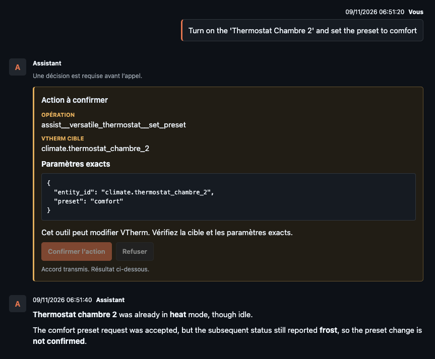

[![GitHub Release][releases-shield]][releases] [![GitHub Activity][commits-shield]][commits] [![License][license-shield]](LICENSE) [![BuyMeCoffee][buymecoffeebadge]][buymecoffee]

# Assistant VTherm

Assistant conversationnel pour diagnostiquer et comprendre les thermostats [Versatile Thermostat](https://github.com/jmcollin78/versatile_thermostat) dans Home Assistant.
Cette documentation prend la release `1.0.0` et ses fonctions récentes comme référence.

> **Confidentialité :** les questions, les réponses d'outils nécessaires au
> diagnostic et le contexte transmis au modèle sont envoyés au fournisseur
> choisi (OpenAI, Google, Anthropic ou au serveur Ollama configuré). N'écrivez
> jamais dans une conversation une clé API, un identifiant, un mot de passe,
> un jeton, une adresse privée sensible ou toute autre information secrète.
> Les secrets saisis dans les champs dédiés ne doivent pas être recopiés dans
> les messages.

## Ce que fait l'assistant

L'assistant découvre dynamiquement tous les outils VTherm annoncés par le serveur
MCP Home Assistant et dont le schéma est accepté, en lecture comme en écriture.
Il lit et explique en langage naturel les données accessibles. Selon les outils
publiés par les versions installées, il peut notamment :

- résumer l'état courant et le diagnostic d'un thermostat : températures,
  consigne, mode, phase de l'algorithme, action, hystérésis, modulation et
  raison publiée par VTherm ;
- examiner les plugins connus de VTherm et leur état, lorsqu'un outil de
  diagnostic des plugins est disponible ;
- consulter l'historique du thermostat, ses journaux techniques et les états
  d'entités liées, lorsque ces outils et données sont accessibles ;
- expliquer une situation telle qu'un thermostat qui ne chauffe pas, comparer
  les observations disponibles ou proposer une piste de vérification ;
- rechercher dans la documentation en ligne officielle de VTherm sur
   [versatile-thermostat.org](https://www.versatile-thermostat.org/), en français,
   anglais ou allemand, et citer les pages utiles.

Les outils et les données accessibles dépendent de Home Assistant, de VTherm,
de l'exposition des entités et de la configuration MCP. Un diagnostic est une
analyse des informations disponibles, pas une garantie de cause ni un accès au
code interne de l'algorithme.

L'assistant peut aussi demander une modification VTherm que son intégration
publie, par exemple changer le mode HVAC, la consigne, un preset ou activer/
désactiver un thermostat. Les possibilités varient selon le thermostat et les
outils MCP effectivement publiés ; ces exemples ne sont pas une liste exhaustive.
Tous les outils d'écriture VTherm publiés et acceptés par le filtre MCP restent
soumis à cette validation. Aucune commande Home Assistant générique n'est exposée.

**Toute écriture exige une validation distincte et obligatoire dans l'interface.**
Avant l'appel, l'assistant affiche le thermostat cible, l'action et tous les
paramètres. Vérifiez-les puis approuvez ou refusez. Une demande initiale dans le
chat ne vaut jamais approbation. En cas de refus, d'ambiguïté ou d'expiration,
l'action n'est pas exécutée. Après approbation, vérifiez toujours dans Home
Assistant le changement réellement effectué et son effet sur le chauffage ;
un résultat d'outil ou une réponse de l'assistant ne remplace pas cette
vérification.

## Aperçu

## Quelques bonnes questions

### Diagnostic

> Donne moi l'état complet de `Thermostat bureau`

> Pourquoi le thermostat s'est éteint vers 12h30 ?

> Fais un bilan de SmartPI

> Est-ce que mes paramètres TPI sont bien configurés ?

> Pourquoi le thermostat bureau est passé en mode sécurité ?

### Actions
> Allumes le `thermostat bureau` et mets le preset sur confort

> Eteint le `thermosstat bureau`

### Les fonctions VTherm

> Comment marche le mode sécurité ?

> Quelle est la différence entre la détection de présence et la détection de mouvement dans Versatile Thermostat ?

A vous de poser vos questions ! Donnez moi vos meilleures conversation dans les [discussions](https://github.com/jmcollin78/vtherm_assistant/discussions/).

## Installer et configurer

La version Home Assistant OS s'installe comme une app depuis le catalogue :

1. Dans **Paramètres > Apps > Boutique d'apps > Dépôts**, ajoutez
   `https://github.com/jmcollin78/vtherm_assistant#ha-app` en conservant le
   suffixe `#ha-app`.
2. Installez **Assistant VTherm** (release `1.0.0`), démarrez l'app et ouvrez-la
   depuis la barre latérale. Aucun port hôte ni carte de tableau de bord n'est
   à ajouter.
3. Configurez le serveur MCP et le jeton personnel dans les paramètres de
   l'assistant comme indiqué ci-dessous.

### Configurer Home Assistant MCP

1. Vérifiez que l'intégration Versatile Thermostat est installée et que les
   thermostats visés sont chargés.
2. Dans **Paramètres > Appareils et services > Ajouter une intégration**,
   ajoutez **Model Context Protocol** (serveur MCP de Home Assistant).
3. Dans les options de l'intégration, publiez les APIs/outils nécessaires à
   VTherm. N'activez pas des ensembles d'outils inutiles. L'assistant filtre les
   outils qu'il accepte et n'expose aucune commande d'écriture Home Assistant
   générique.
4. Dans Home Assistant, exposez à Assist les entités climate VTherm que vous
   voulez rendre découvrables. N'exposez que les entités choisies. Les lectures
   d'état des entités liées sont limitées à celles dont le lien avec le VTherm
   est établi.
5. Pour les détails de l'intégration et de ses options, voir la
   [documentation officielle du serveur MCP Home Assistant](https://www.home-assistant.io/integrations/mcp_server/).

### Créer le jeton Home Assistant

Chaque administrateur configure son propre jeton longue durée pour les appels
MCP. Dans Home Assistant, ouvrez votre **profil utilisateur > Sécurité**,
descendez à **Jetons d'accès longue durée**, choisissez **Créer un jeton**,
donnez-lui un nom reconnaissable (par exemple `Assistant VTherm`) et copiez sa
valeur immédiatement. Home Assistant ne l'affiche pas à nouveau. Dans les
paramètres de l'assistant, enregistrez-le dans le champ du jeton Home Assistant,
jamais dans une conversation, une URL, un fichier du dépôt ou un journal.
Révoquez-le depuis le profil si vous n'en avez plus besoin.

Ce jeton personnel sert à MCP. Il est distinct de la connexion à l'interface et
du `SUPERVISOR_TOKEN` interne de l'app ; ne remplacez pas l'un par l'autre.

### Choisir un modèle

Dans les paramètres, sélectionnez **Google Gemini**, **OpenAI**,
**Anthropic Claude** ou **Ollama**, puis choisissez un identifiant dans le
catalogue ou saisissez-le manuellement. Les catalogues dynamiques listent les
modèles retournés par le fournisseur, mais leur présence ne certifie pas la
compatibilité : choisissez un modèle qui prend en charge les appels d'outils et
le streaming. Les suggestions prédéfinies ne garantissent ni l'accès à un modèle
ni sa compatibilité.

Pour un fournisseur distant, saisissez sa clé uniquement dans le champ prévu.
Pour Ollama, le modèle doit déjà être installé et l'URL doit être joignable
depuis le backend de l'assistant, pas seulement depuis votre navigateur. Après
configuration, faites un premier essai avec une question de lecture.

## Conversations et sauvegardes

L'app conserve automatiquement la conversation courante et son contexte dans
son stockage local privé, séparément pour chaque administrateur Home Assistant.
Elle la restaure après un redémarrage de l'app. Il n'y a pas d'archive de toutes
les anciennes conversations : **Nouvelle conversation** remplace la session
courante de cet utilisateur. Les fragments d'une réponse interrompue ne sont
pas conservés comme réponse complète.

Pour conserver un point de restauration indépendant, faites une sauvegarde
Home Assistant de l'app **Assistant VTherm uniquement**. Une restauration
remplace la conversation, la configuration et les secrets de l'app par ceux de
l'archive ; elle ne doit pas inclure les réglages HA, Recorder, VTherm ou les
autres apps. Les sauvegardes contiennent des secrets non chiffrés au niveau de
la base applicative : protégez l'archive et sa clé. La procédure détaillée est
dans [la documentation d'exploitation](apps/vtherm_assistant/DOCS-fr.md).

## Documentation et développement

- [Guide complet d'exploitation HA OS](apps/vtherm_assistant/DOCS-fr.md)
- [Guide de développement local](docs/development-fr.md)
- [Règles de contribution](CONTRIBUTING-fr.md)
- [Construction et tests de l'app HA](docs/ha-app-build-fr.md)
- [Contrat des sources de diagnostic MCP](docs/contrat-historique-mcp-fr.md)

## Licence

Voir [LICENSE](LICENSE).

***

[vtherm_assistant]: https://github.com/jmcollin78/vtherm_assistant
[buymecoffee]: https://www.buymeacoffee.com/jmcollin78
[buymecoffeebadge]: https://img.shields.io/badge/Buy%20me%20a%20beer-%245-orange?style=for-the-badge&logo=buy-me-a-beer
[commits-shield]: https://img.shields.io/github/commit-activity/y/jmcollin78/vtherm_assistant.svg?style=for-the-badge
[commits]: https://github.com/jmcollin78/vtherm_assistant/commits/master
[forum-shield]: https://img.shields.io/badge/community-forum-brightgreen.svg?style=for-the-badge
[forum]: https://community.home-assistant.io/
[license-shield]: https://img.shields.io/github/license/jmcollin78/vtherm_assistant.svg?style=for-the-badge
[maintenance-shield]: https://img.shields.io/badge/maintainer-Joakim%20Sørensen%20%40ludeeus-blue.svg?style=for-the-badge
[releases-shield]: https://img.shields.io/github/release/jmcollin78/vtherm_assistant.svg?style=for-the-badge
[releases]: https://github.com/jmcollin78/vtherm_assistant/releases
